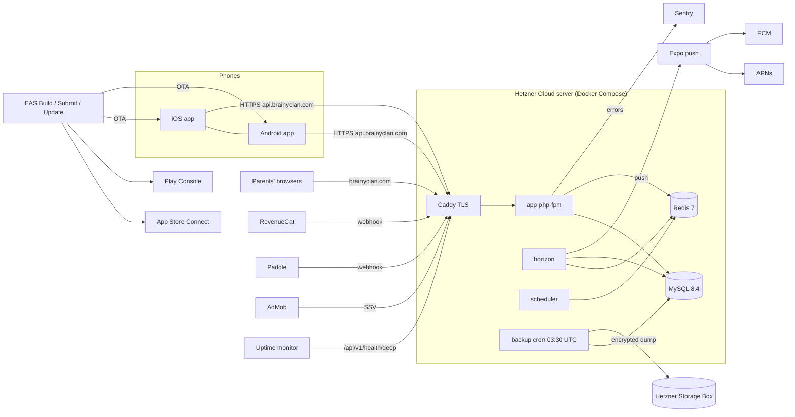

# Brainy Clan — Deployment & Publishing Guide

> **Canonical copy:** `Brainy-Clan-Backend/docs/DEPLOYMENT_GUIDE.md` (versioned). The copy in the
> parent folder `F:\Docker-Projects\Brainy-Clan\DEPLOYMENT_GUIDE.md` is only for convenience — edit
> the backend one and copy it over.

**For:** Moe (owner) and the external agent team (roles and approvals:
[`OPERATIONS_HANDBOOK.md`](OPERATIONS_HANDBOOK.md) §3). **Written:** 2026-10-24.
**Prices checked October 2026 — verify every price before buying** (Hetzner changed its cloud
prices three times in 2026; sources at the end).

This guide answers *where* each part of Brainy Clan runs, *how* it gets there, *how the backend
grows* without overspending, and *what it costs*. It does not repeat long procedures: it links to

| Topic | Detailed source |
| --- | --- |
| Server setup, DNS, email DNS, `.env.prod`, first deploy, updates, rollback, monitoring, backups, Sentry | backend [`docs/DEPLOY.md`](DEPLOY.md) §1–11 |
| Runbooks, approvals, incidents, hard rules | backend [`docs/OPERATIONS_HANDBOOK.md`](OPERATIONS_HANDBOOK.md) |
| External account setup (sign-in, RevenueCat, AdMob SSV, Expo push, Paddle, AI, Sentry) | backend [`README.md`](../README.md) "Setup guides" |
| App builds, EAS profiles/env, credentials, OTA, rollback | app `Brainy-Clan-Frontend/docs/OPERATIONS_HANDBOOK.md` |
| Store listings, audience, age rating, privacy answers, screenshots, review notes, store checklist | app `Brainy-Clan-Frontend/docs/STORE.md` |
| App-side service setup (Google/Facebook/Apple, RevenueCat, AdMob + UMP, push, Sentry) | app `Brainy-Clan-Frontend/README.md` |

Markers: **[Moe]** = needs Moe's explicit approval (handbook §3). **(assumption)** = not verified
in the repos or with the provider. **(not built yet)** = no code exists.

---

## 1. Overview — what runs where

| Part | Where | How it gets there |
| --- | --- | --- |
| **API** `api.brainyclan.com/api/v1`, **admin** `/admin` (Filament), **Horizon** `/horizon` | Hetzner Cloud server, Docker Compose (`docker-compose.prod.yml`) | `git pull` + `docker compose build/up` ([DEPLOY.md §6–7](DEPLOY.md)) |
| **Website** `brainyclan.com` (landing, `/help`, `/support`, `/privacy`, `/terms`, `/account/delete`, `/password/reset`, `/subscribe`) | the same Laravel app and server (Caddy host routing) | same deploy |
| **Queues** (Horizon: `default`, `ai`) and **scheduler** (`schedule:work`) | same server, containers `horizon`, `scheduler` | same deploy |
| **MySQL 8.4**, **Redis 7** | same server, internal Docker network only | containers `mysql`, `redis` |
| **Backups** | `backup` container → nightly encrypted dump → Hetzner Storage Box (rclone/SFTP) | [DEPLOY.md §9](DEPLOY.md) |
| **TLS** | Caddy, Let's Encrypt, automatic | [DEPLOY.md §4](DEPLOY.md) |
| **Email out** (`no-reply@`) | SMTP provider (Postmark / Amazon SES / Mailgun — not chosen yet [Moe]) | `MAIL_*` in `.env.prod`, SPF/DKIM/DMARC ([DEPLOY.md §4 "Email DNS"](DEPLOY.md)) |
| **Email in** (`support@`) | a mailbox provider (Google Workspace / Fastmail / Zoho / forwarding) | MX records |
| **Monitoring** | Sentry (backend + app projects), external uptime monitor on `/api/v1/health/deep` (`X-Health-Token`), alert mails to `OPS_ALERT_EMAIL` | [DEPLOY.md §8, §10](DEPLOY.md) |
| **iOS app** | EAS Build → `eas submit` → App Store Connect → TestFlight → App Store | §4.1 |
| **Android app** | EAS Build (AAB) → Play Console internal → closed → production | §4.2 |
| **OTA updates** | EAS Update, channels `preview` / `production`, fingerprint runtime | §4.4 |
| **In-app subscriptions** | App Store / Google Play → RevenueCat → webhook `/api/v1/webhooks/revenuecat` | backend README "RevenueCat", app README "Family plan purchases" |
| **Web checkout** | Paddle (merchant of record) → webhook `/api/v1/webhooks/paddle` | backend README "Web checkout (Paddle) — setup" |
| **Rewarded ads** | AdMob (teens/adults on free tier only) → SSV `/api/v1/webhooks/admob-ssv` | backend README "AdMob rewarded ads", app README "Rewarded ads — AdMob setup" |
| **Push** | server → Expo push API → APNs (iOS key in EAS) / FCM V1 (service account in EAS + `google-services.json` in the app) | app README "Push notifications — setup" |
| **AI content generator** (optional) | Anthropic API, called from the `ai` Horizon queue | backend README "AI batch generator" |



---

## 2. Backend scaling path and costs

### 2.0 Principles

1. **Scale up before scaling out.** A Hetzner resize is a reboot of a few minutes with the same
   IP and disk; it is the cheapest step and covers a lot of growth. Split servers only when one
   box is no longer enough or you need no-downtime deploys / redundancy.
2. **Keep the stack boring.** Docker Compose on plain VMs, one Laravel codebase, MySQL, Redis.
3. **Move on measured triggers** (§2.4), not on guesses.
4. **All servers in one Hetzner location** once you split (private network, sub-millisecond
   latency). Never put the database at another provider than the app servers (every query would
   pay 10–30 ms).

### 2.1 Region, data location and latency

Hetzner has **no Canadian region**. Options: **EU** (Falkenstein/Nuremberg — Germany; Helsinki —
Finland) or **US** (Ashburn VA = us-east; Hillsboro OR = us-west).

| | US-East (Ashburn) | EU (Nuremberg/Falkenstein) |
| --- | --- | --- |
| Round trip from Toronto/Montreal | ≈ 15–30 ms (assumption, typical) | ≈ 90–110 ms (assumption) |
| From Vancouver / US West | ≈ 60–80 ms | ≈ 150–170 ms |
| Cheapest 8 GB server (Oct 2026) | CCX13 €43.49 | CX33 €8.49 / CAX21 €10.49 |
| Server types sold | **CPX and CCX only** (no cheap CX/CAX) | all types |
| Storage Box / Object Storage | not offered in the US (assumption: EU-only products — verify) → backups would cross the Atlantic, or use a US S3 bucket | same region |

Notes:
- A quiz answer is one small request; 100 ms extra is noticeable but acceptable. Push, goals and
  reminders are server-side and unaffected.
- **Privacy:** the privacy policy draft has a placeholder *"[confirm data-centre location:
  Germany/Finland (EU) or the United States]"* (`resources/views/legal/{en,fr}/privacy.blade.php`
  line 74) — fill it in with the lawyer [Moe]. Both choices are a transfer outside Canada (PIPEDA:
  disclose it; **Quebec Law 25**: a privacy impact assessment before transferring data outside
  Quebec — general guidance, lawyer decides). If the server is in the US and backups go to an EU
  Storage Box, mention both locations.
- **Decision for Moe [Moe]:** *best experience* = Ashburn; *lowest cost now and especially at
  Stage 1+* = EU. Recommendation below.

### 2.2 Stage 0 — Launch (up to ≈ 2,000 families)

**One server, exactly as in [DEPLOY.md](DEPLOY.md)** (Caddy, app, horizon, scheduler, mysql,
redis, backup on one host).

**Size: 8 GB RAM.** Rough memory budget of the current config (assumption, estimated from the
config values): MySQL ≈ 0.8–1 GB (`--innodb-buffer-pool-size=512M` + overhead), php-fpm up to
12 × ≈ 60 MB ≈ 0.7 GB (`docker/prod/php-fpm.conf`, `pm.max_children = 12`), Horizon up to 10
`default` workers + 1 `ai` worker ≈ 0.7–1.2 GB (`config/horizon.php` production), Redis, Caddy,
scheduler, OS ≈ 0.6 GB → ≈ 3–3.5 GB at peak. 4 GB works but leaves no headroom for the nightly
dump, builds on the server (`$C build`) and growth; 8 GB lets you raise the InnoDB buffer pool.

| Option | Type (vCPU / RAM / disk) | €/month excl. VAT | ≈ CA$/month* |
| --- | --- | --- | --- |
| **A — recommended for North America:** Ashburn | **CCX13** (2 dedicated / 8 GB / 80 GB) | 43.49 | ≈ 70 |
| A′ cheaper US, tight RAM | CPX21 (3 shared / 4 GB / 80 GB) | 31.99 | ≈ 51 |
| **B — recommended for lowest cost:** Nuremberg/Falkenstein | **CX33** (4 shared / 8 GB / 80 GB) — product page showed "currently not available" in Oct 2026; order if offered | 8.49 | ≈ 14 |
| B′ EU, Arm | CAX21 (4 Arm / 8 GB / 80 GB) — images are built on the server, so they become arm64 automatically; **untested on Arm (assumption)**, test the build first | 10.49 | ≈ 17 |
| B″ EU, always available | CPX32 (4 shared / 8 GB / 160 GB) | 35.49 | ≈ 57 |
| + primary IPv4 | if not included in the listed price | 0.50 | ≈ 1 |
| + Hetzner server backups | +20 % of the server | 1.70–8.70 | 3–14 |
| + Storage Box BX11 (1 TB, off-site dumps) | EU | ≈ 3.20 (Feb 2026 price; verify) | ≈ 5 |

\* Conversion assumed €1 ≈ CA$1.60, US$1 ≈ CA$1.38 (assumption, check the day you buy).

**Recommendation:** start with **Option A (CCX13, Ashburn)** if Moe wants the snappiest app for
Canadian/US families and a US data location (≈ CA$90/month all-in with backups and Storage Box —
inside the 200 CAD budget); choose **Option B (CX33 or CAX21, Nuremberg)** if cost matters more
(≈ CA$25–30/month) and the EU location is acceptable. Because US multi-server setups cost about
twice the EU ones (§2.3), **if growth is expected, starting in the EU avoids a later migration.**
Changing region later = new server + restore from backup + DNS switch (DEPLOY.md §9 "Real disaster
recovery"), a planned maintenance window of ≈ 30–60 min.

**Cloudflare (free) — DNS-only at Stage 0.** You may host the DNS zone on Cloudflare, but keep
`brainyclan.com`, `www` and `api` **DNS-only (grey cloud)**:
- Caddy gets certificates itself (HTTP-01 on port 80) and already compresses responses.
- The app keys throttles and the login lockout on the client IP (`RateLimiter::for('auth')`
  10/min per IP and `'api'` per IP for guests in `CoreServiceProvider`, `web-subscribe` /
  `web-checkout` in `BillingServiceProvider`, `LoginLockout` per email+IP). `bootstrap/app.php`
  trusts only private ranges (`trustProxies(at: ['127.0.0.1', '10.0.0.0/8', '172.16.0.0/12',
  '192.168.0.0/16'])`), and Caddy does not trust incoming `X-Forwarded-For`. **With the orange
  cloud on, every visitor would look like a few Cloudflare IPs** → lockouts and 429s for everyone.
- Turning the proxy on later (for the website only) needs a code/config change first: Cloudflare
  IP ranges in Caddy `trusted_proxies` + `client_ip_headers CF-Connecting-IP` and in
  `trustProxies`, SSL mode **Full (strict)**. Keep `api.` DNS-only (dynamic responses, webhooks).
- The website is small (landing page ≤ 2.5 MB by design, PLAN "Landing page v2"); a CDN is a Stage 2
  topic.

### 2.3 Stage 1 — Growing (split roles, two app servers)

```
                   Hetzner Load Balancer LB11 (TLS, health check /up)
                        │ private network 10.0.0.0/16
          ┌─────────────┴─────────────┐
     app-1 (caddy + app)         app-2 (caddy + app)
          │                           │
          └──────────┬────────────────┘
       worker-1: horizon + scheduler (exactly one) + backup + redis
       db-1: mysql (dedicated vCPU, own backups)
```

| Server | Role | EU (€/mo) | US (€/mo) |
| --- | --- | --- | --- |
| app-1, app-2 | Caddy (HTTP only behind the LB) + php-fpm | 2 × CX33 = 16.98 | 2 × CPX21 = 63.98 |
| worker-1 | Horizon, the **only** scheduler, backup container, Redis | CX33 8.49 | CPX21 31.99 |
| db-1 | MySQL 8.4 (buffer pool ≈ 60 % of RAM) | CCX13 42.99 (dedicated vCPU) or CX43 15.99 | CCX13 43.49 |
| LB11 | Load balancer (≈ €0.012/h since April 2026) | ≈ 7.49 | ≈ 7.49 (assumption: same price in US) |
| Server backups +20 %, Storage Box, IPv4s | | ≈ 15–20 | ≈ 35–40 |
| **Total** | | **≈ €65–95 ≈ CA$105–150** | **≈ €180–220 ≈ CA$290–350** |

**Managed MySQL vs self-managed** (balanced view):

| | Self-managed on Hetzner (recommended) | DigitalOcean Managed MySQL | Aiven for MySQL |
| --- | --- | --- | --- |
| Price | the db-1 server above (€16–43) | from $15/mo (1 GB, single node); HA = primary + standby, from $30 + $30; ≈ $60 per 4 GB node (assumption from pattern) | Startup plans from ≈ $110/mo |
| Latency to Hetzner app servers | < 1 ms (same location) | 10–30 ms per query across providers — **unacceptable** for an N-query request | same problem unless the whole stack moves |
| Backups/PITR | existing nightly encrypted dumps + Hetzner snapshots; add binlog-based PITR if needed | automatic, PITR | automatic, PITR |
| Canada data location | no | **yes (Toronto)** | depends on cloud |

→ **Stay self-managed on Hetzner.** A managed database only makes sense if the *whole* backend moves
to that provider (e.g. DigitalOcean Toronto for Canadian data residency) — a separate decision [Moe].

**Shared-nothing check (verified in the code, 2026-10-24):**

| What | Status | Action for Stage 1 |
| --- | --- | --- |
| Sessions | `SESSION_DRIVER=redis` (`.env.prod.example`) | none |
| Cache, locks, `onOneServer` | `CACHE_STORE=redis` | none |
| Queues | `QUEUE_CONNECTION=redis`; AI on connection `redis-ai` | none |
| API auth | Sanctum tokens in MySQL | none |
| Logs | `LOG_CHANNEL=stderr` | none (Docker logs per node) |
| User uploads | none — avatars are keys, no `Storage::`/`->disk(` calls in `app/` | none |
| Exports | `/me/export` is returned in the response; staff export is mailed synchronously; Monthly payouts CSV is `streamDownload` | none |
| **Filament CSV import** (`ContentItemResource` → `ImportAction`) | the file goes through a **Livewire temporary upload on the local disk** of the node that received it (`FILESYSTEM_DISK` default `local`; no `config/livewire.php`) | **LB sticky sessions** (cookie) for the admin, or point admins at one node, or move temp uploads to S3 (needs `league/flysystem-aws-s3-v3` — not installed — plus a published Livewire config) |
| `app-storage` volume | compiled views/framework cache per node | none (rebuilt on start by `php artisan optimize`) |

→ **Hetzner Object Storage is not needed for Stage 1.** Use it only if the S3 option above is
chosen or for off-site backups (≈ €6.49/mo for 1 TB + 1 TB egress after the April 2026 increase —
assumption from the +28 % announcement on €4.99; verify).

**Scheduler and Horizon (verified):** every scheduled job is `onOneServer()` except
`ops:heartbeat` (deliberately, every scheduler beats) — `GoalsServiceProvider`, `NotificationsServiceProvider`,
`BillingServiceProvider` (2 jobs), `PlayServiceProvider`, `ChatServiceProvider`,
`IdentityServiceProvider`, `CoreServiceProvider` (`horizon:snapshot`). Most also use
`withoutOverlapping()`. Still: **run one `scheduler` container in total** (simplest, and the
heartbeat stays meaningful). Horizon may run on several nodes later (supervisors coordinate through
Redis; the deep health check reads all masters).

**Zero-downtime deploys:** build the images once, push to a registry, then roll node by node:
take app-1 out of the LB (or let its health check fail), `up -d`, check, put it back, then app-2.
Run migrations **once** from worker-1 before the rollout, and only **backward-compatible**
migrations (add columns/tables first, drop in a later release).

### 2.4 Stage 2 — Scale

- **More app nodes** behind the same LB (LB11 handles up to 25 targets — assumption, check the LB
  type limits); upgrade to LB21 if connections demand it.
- **MySQL read replica** (second DB server, async replication) for heavy reads (leaderboards,
  dashboard, history). Needs a code change (§2.6). Keep writes and read-after-write on the primary
  (`sticky`).
- **Separate queue workers by queue.** Today every job except AI runs on `default` (push, listeners,
  notifications, goals). Split into e.g. `notifications` / `push` / `default` with their own Horizon
  supervisors and `waits` thresholds; put the `ai` worker on its own small node if AI batches run
  often.
- **Redis:** separate instances for queues (`maxmemory-policy noeviction`) and cache
  (`allkeys-lru`); today one instance holds both (cache in Redis DB 1, `REDIS_CACHE_DB`).
- **CDN for static assets:** website images/CSS/JS via Cloudflare (proxy on the website host only,
  after the trusted-proxy change) or Bunny CDN; add long `Cache-Control` for `/images`, `/css`,
  `/js` in the Caddyfile.
- **Rate limits review:** `api` 120/min per user, `auth` 10/min per IP and per email, `export`
  1/hour, `chat-post`, `chat-report`, `webhooks` — check against real traffic (Sentry, Caddy logs)
  and carrier-grade NAT (many families behind one IP).
- **Observability:** raise `SENTRY_TRACES_SAMPLE_RATE` briefly to find slow endpoints; Sentry Team
  plan ($26/mo) when the free 5k errors/month or the single seat is not enough; Hetzner metrics +
  node exporter only if needed.
- Rough cost: **EU ≈ €250–350/month, US ≈ €450–600/month** (3–4 app nodes, primary + replica on
  CCX23, 2 workers, LB) — at that point revenue should carry it.

### 2.5 Triggers to move (measure first)

| Signal (where to see it) | Action |
| --- | --- |
| Server CPU > 70 % at the daily peak for a week (Hetzner graphs) or RAM swap/OOM (`docker stats`, `dmesg`) | **Resize** the Stage 0 server (CCX13 → CCX23, CX33 → CX43) [Moe] |
| p95 API latency > 300 ms at peak (Sentry performance, 5 % traces) with CPU high | resize, then Stage 1 |
| Need deploys without the few seconds of downtime, or a single-server outage is no longer acceptable | Stage 1 |
| Horizon "long wait" alerts on `default` (> 60 s) recur at reminder peaks (`OPS_ALERT_EMAIL`) | raise `maxProcesses`, then a worker node (Stage 1) |
| MySQL: CPU > 60 %, connections > 70 % of `--max-connections=100`, working set > buffer pool (`SHOW ENGINE INNODB STATUS`, hit rate < 99 %) | db-1 bigger / own server (Stage 1), then read replica (Stage 2) |
| DB size > ~50 % of disk, or dumps longer than ~30 min | bigger disk / Volume, review retention (`chat:prune` already runs hourly) |
| Families > ≈ 2,000 active (admin dashboard) | plan Stage 1 (≈ 1 month ahead) |

### 2.6 What not to do early (and why)

- **Kubernetes** (incl. managed K8s): control plane, ingress, cert-manager, storage classes and
  upgrades are a part-time job; a few VMs with Compose cover Stages 0–2.
- **Multi-region / active-active:** doubles cost and makes the points ledger and goals consistency
  hard; one region + good backups is enough.
- **Microservices, Octane, Redis Cluster, autoscaling groups:** no measured need; each adds failure
  modes.
- **Managed DB at another provider than the app** (latency, see §2.3).
- **Cloudflare proxy in front of the API** without the trusted-proxy change (§2.2).

### 2.7 Code/config changes needed before Stage 1 (checklist — not done, do not change code without Moe)

Each item checked against the repo on 2026-10-24.

- [ ] **Caddy behind the LB** (`docker/caddy/Caddyfile`): let the LB terminate TLS (Hetzner managed
  certificate needs the zone on **Hetzner DNS**, or delegate `_acme-challenge` to a Hetzner DNS zone;
  otherwise upload a certificate). On app nodes serve plain HTTP (`http://{$API_DOMAIN}`,
  `http://{$WEBSITE_HOST}` site addresses or `auto_https off`) and add a global
  `servers { trusted_proxies static private_ranges }` so the LB's `X-Forwarded-For` reaches PHP.
  Keep the `www` redirect and security headers.
- [ ] **Trusted proxies** (`bootstrap/app.php`): already trusts `10.0.0.0/8` (Hetzner private
  networks) and the Docker ranges — **no change** for the Hetzner LB on a private network. Change
  only if Cloudflare proxying is enabled (add its ranges).
- [ ] **LB health check:** HTTP `GET /up` (Laravel health route, `bootstrap/app.php`) with Host
  `api.brainyclan.com` — on the website host `RouteByHost` redirects `/up` (301) to the API host.
- [ ] **Sticky sessions** on the LB (cookie) for the admin's Livewire uploads (Filament CSV import),
  or S3 temp uploads (§2.3).
- [ ] **Split `docker-compose.prod.yml`** into per-role files (app node: caddy + app; worker:
  horizon + scheduler + backup [+ redis]; db: mysql [+ redis]). Today mysql/redis sit on an
  `internal: true` network: on db-1 publish 3306/6379 **only on the private-network IP** and allow
  them in the Hetzner firewall from the private subnet only. Set `DB_HOST`/`REDIS_HOST` to private IPs.
- [ ] **Backup container:** `docker-compose.prod.yml` hard-codes `DB_HOST: mysql` for `backup` →
  point it at db-1.
- [ ] **Images from a registry:** compose builds on the server (`build:`); for several nodes build
  once (CI or the worker), push to a registry (e.g. GitHub Container Registry), set
  `APP_IMAGE_TAG` to the git SHA, `docker compose pull` on each node. Keep the `previous` tag
  rollback idea (DEPLOY.md §7).
- [ ] **MySQL server settings:** raise `--innodb-buffer-pool-size` (now 512M) to ≈ 60 % of db-1 RAM;
  check `--max-connections=100` ≥ (app nodes × `pm.max_children`) + Horizon processes + scheduler +
  margin. Consider `MYSQL_ATTR_SSL_CA` (already read in `config/database.php`) if traffic leaves a
  trusted private network.
- [ ] **php-fpm per node** (`docker/prod/php-fpm.conf`): `pm.max_children = 12` is sized for 4 GB;
  set per node size (≈ RAM for PHP / 60 MB).
- [ ] **Horizon** (`config/horizon.php`, production `supervisor-1` `maxProcesses = 10`): set per
  worker node; Horizon only on worker nodes.
- [ ] **Scheduler:** exactly one `scheduler` container (worker-1). No code change (onOneServer is in
  place, cache is Redis).
- [ ] **Redis:** set `maxmemory` + `maxmemory-policy noeviction` (queues must never be evicted);
  password stays (`REDIS_PASSWORD`).
- [ ] **Same `.env.prod` on every node** (same `APP_KEY`!), distributed securely (not via git).
- [ ] **Deep health check** per node is fine (shared MySQL/Redis/Horizon); keep one uptime monitor
  on the LB address plus a TCP/HTTP check per node if wanted.

Before Stage 2 additionally:
- [ ] **Read replica:** `config/database.php` `mysql` has no `read`/`write` split — add
  `'read' => ['host' => [env('DB_READ_HOST')]]`, `'write' => ['host' => [env('DB_HOST')]]`,
  `'sticky' => true` (new env `DB_READ_HOST`, **(not built yet)**).
- [ ] **Queue split:** `onQueue()` for push/notification jobs and listeners + supervisors in
  `config/horizon.php` + `waits` entries.

---

## 3. Backend deployment how-to

### 3.1 First deploy

Follow **[DEPLOY.md](DEPLOY.md) §1–6 in order** (server, firewall, Docker, DNS + email DNS, code
and `.env.prod`, first deploy, checks, webhooks). Then §8 monitoring, §9 Storage Box + first backup
+ **restore drill**, §10 Sentry. Production seeders: only `PolicySeeder`, `CategorySeeder`,
`ChallengeTypeSeeder`, `ContentSeeder`, `WordPuzzleSeeder` — **never** `DatabaseSeeder` or
`Demo*Seeder` (handbook hard rule 10).

**Admin user (DEPLOY.md §6, fixed 2026-10-24):** the B11 migration
`2026_10_24_900000_replace_is_staff_with_staff_role.php` **dropped `users.is_staff`**, so the
old `$u->is_staff = true` line no longer works. Create the user without it, then give the
role with the existing command:

```sh
$C exec app php artisan tinker --execute '$u = new App\Modules\Identity\Models\User(["display_name" => "Moe", "email" => "you@example.com", "locale" => "en"]); $u->password = "a-long-unique-password"; $u->save();'
$C exec app php artisan staff:role you@example.com admin     # admin | support | none
```

(`$C` = `docker compose -f docker-compose.prod.yml --env-file .env.prod`, handbook §5.1.)

**Correction — uptime monitor:** UptimeRobot's custom HTTP headers are a **Pro (paid)** feature,
and `/api/v1/health/deep` accepts the token **only** in the `X-Health-Token` header
(`DeepHealthController`). Use a monitor whose plan supports request headers (Better Stack free
tier — verify that request headers are included — or UptimeRobot's paid plan), plus a free plain
monitor on `https://brainyclan.com/`.

### 3.2 Routine deploy, migrations, rollback

- **Routine deploy:** handbook [§5.2](OPERATIONS_HANDBOOK.md#52-deploy-routine) (checks, time
  window, tagging `previous`, `git pull`, `build`, `up -d`, `horizon:terminate`) and DEPLOY.md §7.
  The deploy agent may deploy alone only when the diff has no migrations/seeders/infra/env/package
  changes.
- **Migrations [Moe]:** take a fresh backup right before (`$C run --rm backup backup.sh`), run
  `$C run --rm app php artisan migrate --force` between `build` and `up -d`. **Backward-compatible
  only.** First production deploy after B11: the staff-role migration copies `is_staff = true` to
  `staff_role = 'admin'` and **drops `users.is_staff`** — on a fresh install there is nothing to
  copy (use `staff:role`); on an existing database check `staff:role` assignments afterwards. Its
  `down()` restores the column, but treat it as one-way.
- **Rollback:** handbook [§5.3](OPERATIONS_HANDBOOK.md#53-rollback): code-only →
  `git checkout <previous>` + `APP_IMAGE_TAG=previous $C up -d` (alone); after a migration →
  `migrate:rollback --step=1` only with a safe `down()`, else restore the pre-deploy backup [Moe].
- Caches need nothing by hand (`docker/prod/entrypoint.sh` runs `php artisan optimize`); after raw
  SQL on reference tables: `reference-cache:flush`.

### 3.3 Secrets

- **`APP_KEY`** encrypts the family chat and Apple tokens. Keep a copy in Moe's **password manager,
  separate from the backups**. Never rotate without putting the old key in `APP_PREVIOUS_KEYS`
  (comma-separated) — handbook hard rule 11, DEPLOY.md §5. Same key on every node.
- **`BACKUP_PASSPHRASE`**: password manager too; without it no dump can be restored.
- Also in the password manager: DB/Redis passwords, Apple `.p8` key, production review account,
  admin credentials, Storage Box password. `.env.prod` is `chmod 600`, never in git, never pasted.
- Where every secret lives: handbook [§2 "Where secrets live"](OPERATIONS_HANDBOOK.md#where-secrets-live-names-only--never-copy-values-anywhere).

### 3.4 Environment checklist per service (`.env.prod`, template `.env.prod.example`)

| Service | Keys | Required at launch? | Setup guide |
| --- | --- | --- | --- |
| Central domain | `CENTRAL_DOMAIN=brainyclan.com` — every host, URL and address below is derived from it with `${CENTRAL_DOMAIN}` (Compose and Laravel both expand it; a secret containing `$` goes in single quotes) | yes | DEPLOY.md §5 |
| Hosts / TLS | `API_DOMAIN`, `WEBSITE_HOST`, `ACME_EMAIL`, `APP_URL`, `WEBSITE_URL` (derived), `APP_IMAGE_TAG` | yes | DEPLOY.md §4–5 |
| Laravel core | `APP_KEY` (+ `APP_PREVIOUS_KEYS` only during rotation), `APP_ENV=production`, `APP_DEBUG=false`, `LOG_LEVEL`, `CORS_ALLOWED_ORIGINS` (empty: native apps need none) | yes | DEPLOY.md §5 |
| MySQL / Redis | `DB_*`, `DB_ROOT_PASSWORD`, `REDIS_*`, `CACHE_STORE=redis`, `SESSION_DRIVER=redis`, `QUEUE_CONNECTION=redis` | yes | DEPLOY.md §5 |
| SMTP | `MAIL_HOST`, `MAIL_PORT`, `MAIL_USERNAME`, `MAIL_PASSWORD`, `MAIL_FROM_ADDRESS=no-reply@${CENTRAL_DOMAIN}` | yes (every app email: password reset, deletion, web checkout, alerts — one branded template, README "Emails") | DEPLOY.md §4 "Email DNS" |
| Legal | `LEGAL_DRAFT` (true until lawyer review), `LEGAL_COMPANY_NAME`, `LEGAL_POSTAL_ADDRESS`, `LEGAL_PRIVACY_OFFICER`, `LEGAL_CONTACT_EMAIL`, `LEGAL_SUPPORT_EMAIL` | yes | README "Legal, consent and privacy" |
| Sentry | `SENTRY_LARAVEL_DSN`, `SENTRY_ENVIRONMENT`, `SENTRY_TRACES_SAMPLE_RATE` | yes | DEPLOY.md §10 |
| Monitoring | `HEALTH_DEEP_TOKEN`, `OPS_ALERT_EMAIL` (default support@), `OPS_ALERT_WEBHOOK_URL` (optional) | yes / optional | DEPLOY.md §8 |
| Google / Facebook / Apple sign-in | `GOOGLE_CLIENT_ID_WEB/_IOS/_ANDROID`, `FACEBOOK_CLIENT_ID/_SECRET`, `APPLE_CLIENT_IDS`, `APPLE_TEAM_ID`, `APPLE_KEY_ID`, `APPLE_PRIVATE_KEY` | Apple yes (if Google/Facebook offered) | README sign-in sections |
| RevenueCat | `REVENUECAT_WEBHOOK_SECRET`, `REVENUECAT_API_KEY`, `REVENUECAT_ENTITLEMENT=family` | yes | README "RevenueCat" |
| Expo push | `EXPO_ACCESS_TOKEN` (only with Enhanced push security) | optional | README "Expo push notifications" |
| AdMob SSV | none (`ADMOB_SSV_KEYS_URL` optional) — point the ad units' SSV URL at `/api/v1/webhooks/admob-ssv` | — | README "AdMob rewarded ads" |
| Paddle | `PADDLE_ENVIRONMENT`, `PADDLE_API_KEY`, `PADDLE_WEBHOOK_SECRET`, `PADDLE_PRICE_MONTHLY/_SEMIANNUAL/_ANNUAL`, `PADDLE_HOSTED_CHECKOUT_URL` or `PADDLE_CLIENT_TOKEN`, `WEB_CHECKOUT_LINK_STOREFRONTS` (empty) | no — empty = "coming soon" | README "Web checkout (Paddle) — setup" |
| AI generator | `ANTHROPIC_API_KEY` (+ optional `CONTENT_AI_*`) | optional | README "AI batch generator" |
| Backups | `BACKUP_PASSPHRASE`, `BACKUP_RETENTION_DAYS`, `BACKUP_CRON`, `BACKUP_RCLONE_REMOTE`, `RCLONE_CONFIG_STORAGEBOX_*` | yes | DEPLOY.md §9 |

Any `.env.prod` change is **[Moe]**; apply with `$C up -d`.

### 3.5 DNS and email records

All in [DEPLOY.md §4](DEPLOY.md): A/AAAA for `@`, `www`, `api`; MX for the support mailbox; one
merged SPF; DKIM for both mail providers; DMARC `p=none` → `p=quarantine`. Add later:
- **`app-ads.txt`** at `https://brainyclan.com/app-ads.txt` — AdMob uses it to verify the app's
  developer website. Built (2026-10-24): set `ADMOB_PUBLISHER_ID=pub-…` in `.env.prod` and the site
  serves `google.com, pub-…, DIRECT, f08c47fec0942fa0` (404 until set) [Moe: set the id].

---

## 4. Frontend publishing per platform

App identity: name **Brainy Clan**, bundle ID / package **`app.brainyclan`**, scheme `brainyclan`,
marketing version `expo.version` (`app.json`, now `1.0.0`), build numbers remote + auto-increment
(`eas.json`), `runtimeVersion` policy **fingerprint**. Status 2026-10-24: `eas init` not run (no
`extra.eas.projectId`, so OTA and push are off), `eas.json` submit IDs are placeholders, no store
apps exist yet.

One-time: `npx eas-cli@latest login`, `npx eas-cli@latest init` (commit the `projectId` change),
EAS environment variables per environment (app handbook §4; secret `SENTRY_AUTH_TOKEN` with
`--visibility secret`).

### 4.1 iOS (App Store)

1. **Apple Developer Program** (US$99/year; organisation account needs a D-U-N-S number — the
   seller name shows on the store).
2. **App ID** `app.brainyclan` with capabilities **Sign in with Apple** (synced by EAS from
   `ios.usesAppleSignIn`), **Push Notifications** (APNs key via `eas credentials`), **In-App
   Purchase** (enabled for App IDs by default).
3. **App Store Connect** app record: bundle `app.brainyclan`, SKU `brainyclan-ios`, primary language
   English (Canada or U.S.) + French. Put `ascAppId` and `appleTeamId` into `eas.json` →
   `submit.production.ios` (replace `REPLACE_WITH_…`).
4. **Subscriptions:** `brainyclan_family_monthly`, `brainyclan_family_6months`,
   `brainyclan_family_annual` in one group, attached in RevenueCat to entitlement `family`; the first
   subscription is submitted with the app version. Paid Apps agreement, tax and banking done.
   Apple Small Business Program (15 %) — apply.
5. **Build and submit:** `npx eas-cli@latest build --platform ios --profile production` →
   `npx eas-cli@latest submit --platform ios --profile production --latest` → TestFlight (15–30 min
   processing). Internal testers immediately; external testers after Beta App Review.
6. **Listing:** texts STORE.md §4/§5; **screenshots iPhone 6.9" (1320×2868) and iPad 13"
   (2064×2752)** — required because `supportsTablet: true` (STORE.md §8); support URL
   `https://brainyclan.com/support`, marketing URL `https://brainyclan.com`, privacy URL
   `https://brainyclan.com/privacy`.
7. **Age rating:** answer honestly (STORE.md §6) — expected 4+, but "Messaging and chat: Yes" may
   raise it; accept what App Store Connect computes. **Not** in the Kids Category.
8. **App Privacy labels:** STORE.md §7 table (tracking: No; check "Other User Content" vs "Emails
   or Text Messages" for the chat).
9. **Review notes:** STORE.md §9 template + the production **review family** (adult admin, child
   "Sam" 9, teen "Alex" 14) — credentials only in App Store Connect's fields, never in docs.
   Mention account deletion (Profile → Privacy), Sign in with Apple, chat report/parent controls
   (guideline 1.2).
10. Submit **[Moe]** → release with **phased release (7 days)**.

### 4.2 Android (Google Play)

1. **Play Console** account (US$25 one-time). New personal accounts: **closed test with ≥ 12
   testers for 14 days** before production access (STORE.md §10).
2. **Create the app** (default language en-US/en-CA + fr-CA/fr-FR, App, free).
3. **App signing:** EAS generates the upload keystore (back it up via `eas credentials`); enrol in
   **Play App Signing**. Register the SHA-1 of every signing key (EAS dev keystore, Play app
   signing key) as Google Android OAuth clients and Facebook key hashes (app README).
4. **First AAB uploaded by hand** (Internal testing → Create release); afterwards
   `npx eas-cli@latest submit --platform android --profile production --latest` (track `internal`,
   `draft`). Service-account JSON for submit in EAS credentials, never in git.
5. **FCM (push):** Firebase project with Android app `app.brainyclan`; FCM V1 service-account key
   into EAS credentials; **`google-services.json` + `android.googleServicesFile` in `app.json` —
   not configured yet** (handbook §14.1 item 4). Native change → new build; it contains no
   secrets but is project-specific.
6. **App content:** privacy policy URL; **App access** (review family, STORE.md §9); **Ads:
   contains ads**; **content rating** IARC (expected Everyone, users interact = private family
   chat); **target audience 6–8, 9–12, 13–15, 16–17, 18+** → Families Policy (AdMob certified, no
   ads to children, rated G); **Data safety** (STORE.md §7) incl. account deletion URL
   `https://brainyclan.com/account/delete`.
7. **Play Billing products:** the same three subscription IDs, base plans + trials per B10, linked
   in RevenueCat (service credentials for RevenueCat per the app README).
8. Tracks: **internal** (≤ 100 testers) → **closed** (waitlist families) → **production** with a
   **staged rollout** (20 % → 100 %) **[Moe]**.
9. Target API level: Expo SDK 57 sets a current `targetSdkVersion`; check Play's yearly
   target-API deadline before each release (assumption: compliant out of the box).

### 4.3 Web

**Decision (PLAN, handbook §12.2): no public web app at launch.** The public website is the
**Laravel** site on `brainyclan.com`; the Expo web build (`npm run web`, `app.json`
`web.output: static`) is a **development/preview target** (themes preview, quick checks;
`npx expo export --platform web` must bundle). Native-only features (RevenueCat, AdMob, push) have
`.web.ts` stubs. A "web version" is listed under "Later" (app PLAN; web subscriptions via Paddle).

If a hosted web app is approved later [Moe] (option, not planned): build with
`npx expo export --platform web`, host the `dist/` folder as static files on **Cloudflare Pages**
(free tier) or any static host at e.g. `app.brainyclan.com`, add that origin to
`CORS_ALLOWED_ORIGINS` in `.env.prod`, configure Google/Facebook/Apple web redirect URIs (Apple
Services ID), review token storage in the browser, and add it to the privacy answers.

### 4.4 OTA updates policy (EAS Update)

- **May ship OTA:** JS/TS logic and screens, bug fixes, translations, images/sounds bundled by Metro.
- **Never OTA (needs a store build):** new/upgraded native modules or SDKs, Expo SDK upgrades, any
  `app.json`/`app.config.ts` change (plugins, permissions, schemes, AdMob app IDs, Google iOS client
  ID, Facebook app ID, `google-services.json`), `expo.version`; anything that changes the app's
  purpose, needs new privacy answers or review, or touches ad/child rules.
- Commands: `npx eas-cli@latest update --channel preview --environment preview --message "…"`
  (agent alone); production channel **[Moe]**. Always the matching `--environment`. Rollback: app
  handbook §6 (`update:republish` / `update:roll-back-to-embedded`). Upload source maps after a
  production update (`npx sentry-expo-upload-sourcemaps dist`).
- EAS free plan includes **1,000 OTA monthly active users** — above that OTA needs a paid plan
  (Starter: 3,000 MAU) [Moe].

### 4.5 Versioning and force update

- `expo.version` = marketing version, bumped by hand for every store release (1.0.1 fixes, 1.1.0
  features); iOS `buildNumber` / Android `versionCode` are bumped by EAS (`appVersionSource: remote`,
  `autoIncrement`); first time `npx eas-cli@latest build:version:set` if EAS asks.
- **Force update:** global setting `min_app_version` (Admin → Policy → Settings & flags, seeded
  `1.0.0`). Older apps (header `X-App-Version`) get **426 `app_update_required`**;
  `/api/v1/health` is exempt. Raise it only after the new version is live in **both** stores **[Moe]**.

### 4.6 Store review timelines (approximate — plan buffers)

| Step | Typical |
| --- | --- |
| TestFlight processing | 15–30 min |
| TestFlight external (Beta App Review) | ≈ 1 day |
| App Store review | usually 24–48 h; first submission and rejections add days |
| Play internal testing | minutes |
| Play closed test for new personal accounts | **14 days minimum** + production access review (days) |
| Play review of a new app / first production release | several days, up to ~7 or more |
| Play updates | hours to ~3 days |

→ Start the Play closed test **at least 3 weeks** before the planned launch date.

---

## 5. Cost summary at launch (prices checked October 2026 — verify)

Assumed €1 ≈ CA$1.60, US$1 ≈ CA$1.38.

| Item | Option A (Ashburn CCX13) | Option B (EU CX33/CAX21) | Notes |
| --- | --- | --- | --- |
| Server | €43.49/mo | €8.49–10.49/mo | §2.2; + €0.50 IPv4 if not included |
| Hetzner server backups (+20 %) | €8.70/mo | €1.70–2.10/mo | whole-server snapshots, 7 kept |
| Storage Box BX11 (off-site dumps) | ≈ €3.20/mo | ≈ €3.20/mo | Feb 2026 price; EU location |
| Domain `brainyclan.com` | ≈ CA$20–25/year | same | registrar dependent |
| Outbound email | Postmark $15/mo (10k emails) or Amazon SES ≈ $0.16 per 1,000 (Essentials, new accounts since July 2026) | same | low volume → SES ≈ $1/mo; Postmark simpler deliverability |
| Support mailbox | ≈ $0–8/user/mo | same | forwarding is free; Workspace/Fastmail paid |
| Uptime monitor with header | $0 (Better Stack free, verify headers) or ≈ $7–8/mo (UptimeRobot Solo/Pro, assumption) | same | §3.1 |
| Sentry | $0 (Developer: 1 user, 5k errors/mo); Team $26/mo | same | backend + app projects share the quota |
| Apple Developer Program | US$99/year | same | |
| Google Play Console | US$25 once | same | |
| EAS (Expo) | $0 (15 iOS + 15 Android builds/mo, low-priority queue, 1,000 OTA MAU); Starter $19/mo | same | Starter when OTA users > 1,000 or builds queue too long |
| RevenueCat | $0 up to $2,500 monthly tracked revenue, then 1 % of tracked revenue | same | |
| Store commission | 15 % (Apple Small Business Program, Google subscriptions) | same | PLAN B10 |
| Paddle (web checkout) | 5 % + $0.50 per transaction (+ FX spread) | same | only when live |
| AdMob | $0 (pays you) | same | |
| Anthropic API | ≈ US$0.10–0.20 per 50-item batch; set a monthly limit | same | optional |
| **Fixed infrastructure total** | **≈ €55–57 + email ≈ CA$90–110/month** | **≈ €13–16 + email ≈ CA$25–45/month** | both under the 200 CAD/month budget |
| **One-time / yearly** | Apple US$99/yr, Google US$25 once, domain ≈ CA$20–25/yr | | |

The DEPLOY.md §11 table (≈ 15–35 CAD, CX22 ≈ €5) predates the 2026 Hetzner price changes —
update it when the server is bought.

---

## 6. Launch day and who does what

### 6.1 Launch-day checklist (order)

The full pre-launch list is handbook [§12.4](OPERATIONS_HANDBOOK.md#124-launch-checklist-in-order)
and STORE.md §10. On launch day:

1. [ ] **T-1 day:** last backup succeeded and a fresh one taken; restore drill done this month;
   `LEGAL_DRAFT=false` with the lawyer-reviewed texts; region statement in the privacy policy filled.
2. [ ] Health: `/api/v1/health` 200, `/api/v1/health/deep` 200 with the token, website 200, `www`
   301, `$C ps` all healthy, `horizon:status` running, `schedule:list` shows the jobs.
3. [ ] Uptime monitors green and alerting to Moe; Sentry receives (`sentry:test`); `OPS_ALERT_EMAIL`
   delivers (SMTP works).
4. [ ] Webhooks: RevenueCat delivery log shows 200; AdMob SSV "Verify URL" OK; Paddle only if live.
5. [ ] `min_app_version` = the live version (`1.0.0`).
6. [ ] Review family works on production; demo/seed accounts **absent** from production.
7. [ ] App: iOS approved → release (phased); Android production staged rollout 20 % **[Moe]**.
8. [ ] Smoke test from the store builds: sign-up, Apple/Google sign-in, invite + child sign-in code,
   play each challenge type, goal, chat, paywall purchase (real card, then refund/cancel), rewarded
   ad as a free adult, push, French.
9. [ ] Watch for 48 h: Sentry (backend + app crash-free rate), Horizon waits, server CPU/RAM, DB
   connections; no deploys on launch day without Moe (handbook §5.2).
10. [ ] `app-ads.txt` live on `brainyclan.com` (§3.5).

### 6.2 Who does what

| Task | Moe | Agents (role, handbook §3) |
| --- | --- | --- |
| Accounts: Hetzner, Apple, Google Play, Expo, RevenueCat, AdMob (+UMP), Sentry, SMTP, mailbox, uptime monitor, Paddle, Anthropic | **creates, owns, pays** | — |
| Region choice, server size, resizes, Stage 1/2 moves | **decides** [Moe] | Deploy agent prepares, Finance agent costs, Monitoring agent reports triggers |
| `.env.prod`, secrets, `APP_KEY`/`BACKUP_PASSPHRASE` copies, rotation | **only Moe** | never see/paste values |
| DNS, firewall, compose/Caddy changes | approves [Moe] | Deploy agent executes after approval |
| First deploy + production seeders + admin user | approves, gives `admin` role | Deploy agent runs DEPLOY.md |
| Routine deploy of reviewed `main` (no migrations/infra) | merges to `main` | **Deploy agent alone** (§5.2 checks) |
| Migrations, `migrate:rollback`, restore into live DB | **approves** | Deploy agent executes |
| Code rollback without migration, container restarts | informed | **Deploy / Monitoring agent alone** |
| Backups check daily, monthly restore drill | — | Deploy + Monitoring agents |
| Store accounts, listings, privacy answers, age rating, prices, products | **approves** [Moe] | App release / Marketing agents draft |
| `development`/`preview` builds, preview OTA, TestFlight/internal distribution | — | **App release agent alone** |
| Production submission, release, production OTA, `min_app_version` | **approves** [Moe] | App release agent executes |
| Rolling back a bad production OTA | informed | **App release agent alone** |
| Code/doc changes (Caddyfile, trusted proxies, `app-ads.txt`, queue split…) | reviews and commits | written up as issues; never committed by agents |

---

## Known doc gaps found while writing (for Moe)

1. ~~`docs/DEPLOY.md` §6 admin-user command sets `is_staff`~~ — fixed 2026-10-24 (uses `staff:role`);
   §3.1 above.
2. ~~`docs/DEPLOY.md` §8 UptimeRobot free + custom headers~~ — fixed 2026-10-24 (headers need a plan that supports them);
   custom headers are UptimeRobot Pro.
3. `docs/DEPLOY.md` §11 now points here for costs; §1 and handbook §5.8: CX22 / ≈ €5 and the 15–35 CAD total predate the 2026
   Hetzner prices; US locations offer only CPX/CCX (CPX11 €17.49, CPX21 €31.99, CCX13 €43.49).
4. ~~No `app-ads.txt` for AdMob~~ — built 2026-10-24 (`ADMOB_PUBLISHER_ID`).
5. `google-services.json` / `android.googleServicesFile` still missing in the app (known, handbook
   §14.1 #4).

## Sources (checked October 2026)

- Hetzner price adjustment 15 June 2026 (official table, EU/US/SG):
  <https://docs.hetzner.com/general/infrastructure-and-availability/price-adjustment/>
- Hetzner cost-optimized (CX/CAX) and regular-performance (CPX) product pages:
  <https://www.hetzner.com/cloud/cost-optimized>, <https://www.hetzner.com/cloud/regular-performance>
- Price tables and location availability (CX/CAX EU-only, US CPX/CCX only, LB11 €7.49):
  <https://costgoat.com/pricing/hetzner>; US increases: <https://northflank.com/blog/hetzner-cloud-server-price-increases>;
  CX availability: <https://findstack.com/resources/hetzner-price-increase-2026>;
  waves: <https://capitalandcompute.net/blog/hetzner-price-increase-2026/>
- Hetzner LB features (private network, PROXY protocol, locations):
  <https://docs.hetzner.com/networking/load-balancers/faq/>; managed certificates need Hetzner DNS:
  <https://docs.hetzner.com/networking/certificates/overview>,
  <https://community.hetzner.com/tutorials/configure-lb-cert-with-external-domain>
- Hetzner Object Storage (€4.99 base before April 2026, +28 %): <https://www.hetzner.com/object-storage/>;
  Storage Box BX11 ≈ €3.20 (Feb 2026) via search summary — verify on hetzner.com/storage/storage-box
- DigitalOcean Managed MySQL: <https://docs.digitalocean.com/products/databases/mysql/details/pricing/>
- Aiven for MySQL: <https://aiven.io/pricing/mysql>
- Expo EAS plans: <https://vibecoding.app/blog/expo-eas-review>, <https://pricingsaas.com/companies/expo>
- RevenueCat: <https://www.costbench.com/software/subscription-billing/revenuecat/>
- Sentry: <https://costbench.com/software/developer-tools/sentry/free-plan/>
- Postmark: <https://www.emailsoftwareinsights.com/reviews/postmark/pricing/>; Amazon SES:
  <https://www.usecarly.com/blog/amazon-ses-pricing/>
- Paddle: <https://paddle.com/pricing>
- UptimeRobot custom headers (Pro): <https://uptimerobot.com/blog/new-feature-custom-http-headers-for-the-pro-plan>
- Apple Developer Program US$99/year and Google Play US$25 one-time: the providers' enrolment pages
  (unchanged; verify at enrolment).
